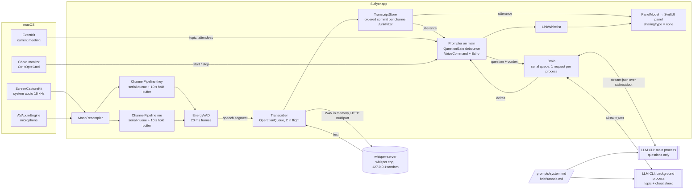
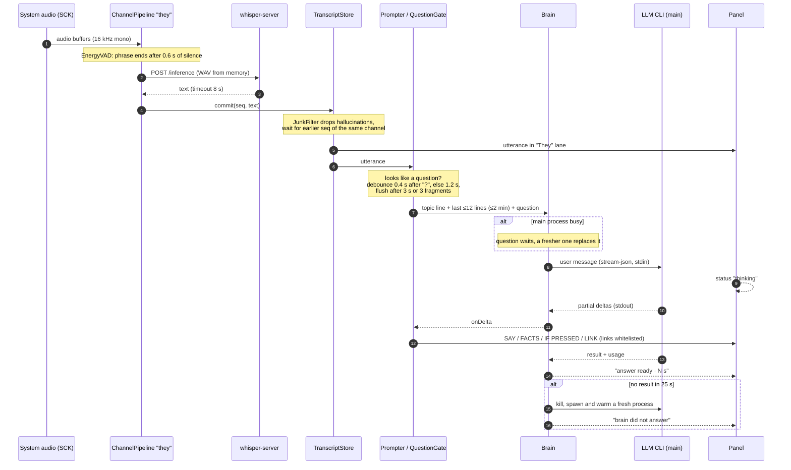

# Suflyor

A macOS menu-less floating panel that listens to a live call (Zoom, Meet, Telegram, anything that plays sound), transcribes both sides locally and shows a short "what to say next" hint from an LLM within seconds. Built for people who answer a lot of product, sales or interview questions on calls and want facts from their own brief at a glance.

The UI and the default prompt are in Russian; transcription language is configurable.

## Features

- **Two-channel live transcript.** "They" = system audio via ScreenCaptureKit, "Me" = microphone via AVAudioEngine. Both are cut into phrases by an energy VAD and transcribed by a local `whisper-server` (whisper.cpp) on `127.0.0.1`.
- **Automatic hints.** When the other side asks something that looks like a question, the last ≤ 12 lines of the call are sent to a long-lived LLM process; the answer streams into the panel as `SAY` / `FACTS` / `IF PRESSED` / `LINK`.
- **Voice command.** Say "suflyor ..." or "podskazhi" ("give me a hint") to force an answer on the last question, with echo protection against your own speakers.
- **Call topic and cheat sheet.** Topic comes from the current calendar event (EventKit) or is inferred by the LLM after ~1 minute of talk; a cheat sheet for that topic is prepared in a separate background LLM process.
- **Invisible on screen share.** The panel uses `sharingType = .none`, so it is not captured by screen sharing or screenshots; there is a built-in self-test for that.
- **Private by default.** Audio never touches disk, the transcript lives only in memory and is dropped at the end of the session, the app itself only talks to `127.0.0.1`. Links in hints are shown only if they literally exist in your brief.
- **One shortcut.** Press and release Control+Option+Command (no letter) to start or stop a session. Between calls the app sleeps: no capture, no whisper, no LLM.

## Architecture



How it works:

1. Capture callbacks arrive on their own queues (`suflyor.sck.audio`, `suflyor.mic`); samples are downmixed to 16 kHz mono and handed to a per-channel serial queue, so a long monologue on one side never blocks the other.
2. Each channel runs an energy VAD (adaptive noise floor, 0.6 s of silence ends a phrase, 12 s hard cap). Segments are encoded to WAV in memory and posted to whisper; up to 2 requests run in parallel.
3. `TranscriptStore` reserves a sequence number per segment and publishes an utterance only after all earlier segments of that channel are resolved, so parallel transcription never reorders speech. Timestamps are taken from the wall clock at buffer arrival, not from sample counts, so stream restarts and sleep do not drift "me" and "they" apart.
4. `Prompter` (on the main queue) feeds "they" utterances into `QuestionGate`, which glues fragments of one question and fires after a short debounce. It also handles the voice command and echo checks.
5. `Brain` keeps two long-lived CLI processes and a strict one-request-in-flight rule per process. A fresher question replaces the waiting one; answers stream back as deltas and are rendered immediately.
6. Before anything reaches the panel, every URL in the hint and cheat sheet is checked against the brief's link whitelist.

### One cycle: other side asks → hint on screen



Latency budget visible in the code (not a benchmark): end-of-phrase detection 0.6 s, whisper round trip on a local model, question debounce 0.4-1.2 s (hard limit 3 s), then time-to-first-token of the LLM. The voice command adds a deliberate 1.2 s wait to rule out speaker echo. The real time-to-first-word and full answer time are printed by `--e2e-call` and `--brain-smoke` and shown above every hint in the panel.

## Key engineering decisions

- **Long-lived LLM processes instead of a request per question.** Cold start costs seconds, and the hint is only useful while the other person is still waiting. The main process is warmed up at session start and replaced with a pre-warmed standby after 25 answers or 150k input tokens per turn, so time-to-first-token does not grow with context.
- **Two processes, not one.** A cheat sheet takes tens of seconds; a question queued behind it would be useless. Topic detection and cheat sheet go to a lazily started background process on a cheaper model; questions never wait for it.
- **One request in flight per process, latest question wins.** Writing the next message before the previous result makes answers drift between questions, and one hung answer blocks everything behind it. Stale questions are dropped, not answered late.
- **Self-healing with budgets.** No result in 25 s - kill and respawn. A crash is retried once with the same question; a second crash in a row marks the brain unavailable while transcription keeps working. Similar budgets exist for the microphone (device change, 5 retries), system audio (3 restarts, reset after 60 s of stable work) and whisper (one restart on a new port, then a visible error).
- **Capture starts before whisper is ready.** Channels hold up to 10 s of audio in memory while `whisper-server` boots, so the first words of the call are not lost.
- **Energy VAD, not a neural one.** It only has to cut phrases for whisper; junk is removed at the text level (`JunkFilter` plus whisper's non-speech-token suppression).
- **Wall-clock timestamps.** Sample-count time drifts on every stream gap; echo detection and ordering need both channels on one clock.
- **Echo handling.** On speakers the mic hears the other side. A "me" line that matches a "they" line in the same time window is not sent as context and is not treated as a command.
- **Isolated LLM process.** Allow-listed environment (`HOME`, `PATH`, `LANG`, ...), no tools, no MCP servers, no user settings, no session persistence, an empty temp working directory deleted at the end. Transcript lines are explicitly framed as data, not instructions (prompt-injection from the call).
- **Loopback-only networking in the app.** The whisper client refuses any host other than `127.0.0.1`; only the child LLM process goes out to the network. Orphaned `whisper-server` processes and stale temp dirs from a crashed run are cleaned up at launch.
- **Stable code signature.** Signing with a persistent local certificate keeps the designated requirement constant, so macOS privacy grants survive rebuilds. No hardened runtime: without the audio-input entitlement it silently returns silence from the mic.

## Scale

- 25 source files in the core library, ~5.7k lines of Swift; ~3.1k lines of tests.
- 181 tests in 52 suites (Swift Testing); the LLM is replaced by a fake executable in tests, so they need no network or API limits.
- 2 long-lived LLM processes per session, 1 local whisper server, 2 independent audio pipelines.

## Requirements

- macOS 14 Sonoma or later (Apple Silicon recommended for whisper speed).
- Swift 6 toolchain: Xcode 16+ or Command Line Tools only (Xcode is not required).
- `whisper-server` from whisper.cpp at `/opt/homebrew/bin/whisper-server` (`brew install whisper-cpp`) and a ggml model at `~/Library/Application Support/Suflyor/ggml-small.bin`.
- An LLM command-line client that speaks a line-delimited stream-json protocol over stdin/stdout (`--input-format stream-json --output-format stream-json`, partial messages, `--system-prompt-file`, `--model`). Point `SUFLYOR_BRAIN_BIN` to it, or put it on `PATH` as `llm-cli`. Without it the app still transcribes, but shows no hints.

macOS permissions (the app asks for each one itself):

| Permission | Why | Asked |
| --- | --- | --- |
| Accessibility | global Ctrl+Opt+Cmd chord in other apps | at launch |
| Microphone | "Me" channel | first session |
| Screen & System Audio Recording | "They" channel (system audio; no video is used) | first session, app relaunches itself after grant |
| Calendars (read) | call topic and attendees from the current event | first session, can be turned off in the panel menu |

## Tech stack

Swift 6 (Swift 5 language mode), SwiftUI + AppKit (`NSPanel`), ScreenCaptureKit, AVFoundation, EventKit, NSEvent global monitors (modifier chord) and Carbon HIToolbox, `Process` + pipes for child processes, URLSession (ephemeral, loopback-only), whisper.cpp server, Swift Testing, SwiftPM, LaunchAgent for autostart.

## Project structure

```
Package.swift            SwiftPM: SuflyorKit library, Suflyor executable, tests
Sources/
  Suflyor/main.swift     entry point and CLI modes (--selftest-capture, --e2e-call, --brain-smoke)
  SuflyorKit/
    AudioCapture.swift   mic (AVAudioEngine) and system audio (ScreenCaptureKit), restart budgets
    EnergyVAD.swift      phrase segmentation
    Transcriber.swift    per-channel pipelines, hold buffer, whisper request queue
    WhisperServer.swift  whisper-server lifecycle, loopback HTTP client, startup cleanup
    TranscriptStore.swift ordered in-memory transcript, subscribers
    JunkFilter.swift     drops whisper hallucinations and repeats
    Questions.swift      question detection, debounce gate, voice command, echo, topic detection
    Prompter.swift       glue: utterances → brain → panel; prompt/brief paths
    Brain.swift          long-lived LLM processes, queueing, timeouts, restarts, replacement
    BrainProtocol.swift  stream-json parsing, launch arguments, environment allow-list
    HintFormat.swift     parsing of SAY / FACTS / IF PRESSED / LINK and cheat sheets
    LinkWhitelist.swift  links allowed only from the brief
    CalendarWatch.swift  picks the current meeting from EventKit
    Panel*.swift, Placement.swift  SwiftUI panel, state model, display placement
    Chord.swift, HotKeys.swift     Ctrl+Opt+Cmd detection, permissions
    SelfTest.swift       proves the panel is invisible in screen capture
    E2ECall.swift        offline end-to-end run on two audio files
    DebugLog.swift       opt-in session log (off by default)
Tests/SuflyorKitTests/   unit, process and pipeline tests with a fake LLM
prompts/system.md        system prompt for hints
briefs/product.md        example brief (facts, prices, links) for the "product" mode
Resources/Info.plist     bundle metadata and permission strings
scripts/                 build-app, run, test, fake call generator, autostart install/uninstall
```

## Getting started

```bash
scripts/build-app.sh                 # build/Suflyor.app, signed with "Suflyor Local" cert or ad-hoc
scripts/run.sh                       # launch; then press and release Ctrl+Opt+Cmd
scripts/test.sh                      # all tests
SUFLYOR_E2E=1 scripts/test.sh        # plus an end-to-end test with real whisper (~10 s)
```

Without Xcode, plain `swift test` cannot find Swift Testing inside Command Line Tools, so `scripts/test.sh` passes the framework paths explicitly.

Offline end-to-end run without any macOS permissions:

```bash
scripts/make-fake-call.sh            # synthesizes test-audio/they.wav and me.wav with `say`
build/Suflyor.app/Contents/MacOS/Suflyor --e2e-call test-audio/they.wav test-audio/me.wav --speed 2
```

It feeds both files through the same VAD → whisper → transcript → question gate → LLM path and prints time-to-first-word and the hint for every question.

Other useful commands:

```bash
scripts/run.sh --selftest-capture    # verify the panel is not captured on screen share
build/Suflyor.app/Contents/MacOS/Suflyor --brain-smoke "Client: how much is it for 20 users?"
scripts/install-login.sh [--dry-run] # autostart via LaunchAgent com.danila-builds.suflyor
```

Configuration is via environment variables (see `.env.example`): `SUFLYOR_BRAIN_BIN`, `SUFLYOR_BRAIN_MODEL`, `SUFLYOR_BRAIN_EFFORT`, `SUFLYOR_LANG` (default `ru`, `auto` to detect), `SUFLYOR_HOME` (where `prompts/` and `briefs/` live), `SUFLYOR_DEBUG=1` (session log to `~/Library/Logs/Suflyor/debug.log`, contains call text). Put your own brief in `briefs/product.md` or point `BRIEFS_DIR` to a folder at build time; real briefs are git-ignored.

Running the full app needs real whisper and an LLM CLI; tests and the build do not.

## License

MIT, see [LICENSE](LICENSE).
